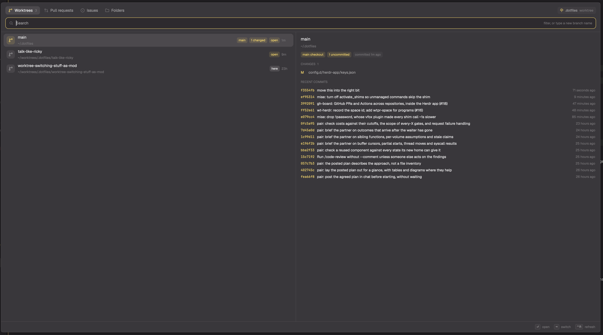

# Grove

A [Herdr app](https://herdr.dev) mod for working in git worktrees. One native dialog lists the focused repo's worktrees, its open pull requests and issues, and zoxide's frecent folders, and opens any of them as a Herdr space. A PR becomes a worktree of its branch; an issue becomes a worktree named after it, with an agent started on it.



## Why

Herdr's own worktree actions keep every checkout under `~/.herdr/worktrees`. Grove puts them beside the repo instead, at `<parent>/worktrees/<repo>/<branch>`. Per-directory configuration (mise, direnv) scoped to the parent folder still applies inside them; a single global root can't express that, and a worktree that silently loses its environment runs agents on the wrong profile.

It replaces a set of shell pickers (fzf in hidden terminals, one per job) with one dialog that shows state the pickers could not: which worktrees have an open space, uncommitted changes or a merged PR, and a preview of the selected PR, issue or checkout.

## Install

```sh
git clone https://github.com/radiosilence/grove ~/workspace/radiosilence/grove
cd ~/workspace/radiosilence/grove
mise run install    # copies mods/* into ~/.config/herdr-app/mods, lists missing keys
```

`bin/install` respects `HERDR_APP_HOME`. It copies rather than links because `svg()` resolves icon paths inside the app's folder, and an icon behind a symlink to elsewhere doesn't draw; run it again after pulling. It never overwrites a mod folder it didn't install, and it does not edit `keys.json`: it prints each suggested key as `add` (free) or `taken` (bound to something else), so you merge what you want.

Requires `git`. The PR and issue tabs need an authenticated [`gh`](https://cli.github.com); the folders tab needs [`zoxide`](https://github.com/ajeetdsouza/zoxide).

## Keys

From `keys.json`:

| Key | Mod | Opens |
| --- | --- | --- |
| `alt-w` | `grove-worktrees` | Worktrees |
| `alt-shift-p` | `grove-prs` | Pull requests |
| `alt-shift-i` | `grove-issues` | Issues |
| `cmd-shift-n` | `grove-folders` | Folders |
| `cmd-]` / `cmd-[` | `grove-next` / `grove-prev` | next / previous space in sidebar order |
| `cmd-;` | `grove-shell` | scratch shell in the focused folder |

`mod.open:grove` opens the dialog on the tab used last. Inside it:

| Key | Does |
| --- | --- |
| type | filter; every word must match |
| `↑` `↓` `⌃N` `⌃P` `PgUp` `PgDn` | move |
| `↵` | open, create, check out or start |
| `⇥` / `⇧⇥` | next / previous tab |
| `⌃X` | remove the selected worktree (press twice) |
| `⌃O` | PR or issue in the browser; folder in Finder |
| `⌃R` | reload the tab |
| `esc` | cancel a pending removal, else close |

## Tabs

**Worktrees.** Every checkout of the focused repo, main first, then by last commit. Each row shows whether a space has it open, uncommitted changes, its PR and that PR's state. Enter selects its space or opens one named after the branch. Typing a name no worktree has offers to create it: the existing local branch, else `origin/<name>`, else a new branch from origin's default branch.

`⌃X` twice removes a worktree and closes its space. The branch is deleted with `git branch -d`, or with `-D` when its PR is merged or closed, since squash merges leave nothing for `-d` to recognise. If git refuses (a locked worktree, submodules), a third `⌃X` forces it.

With an empty filter, a **Clean up** row appears when there are finished worktrees: a merged or closed PR, or left by an agent under `.claude/worktrees`. It takes only those that are clean and have no open space, and needs Enter twice.

**Pull requests** and **Issues.** The repo's open PRs and issues from `gh`, filtered to `@me` (the author of a PR, the assignee of an issue); delete it to see everyone's. A PR is checked out from `refs/pull/<n>/head`, so forks work. A fork's PR goes to a local branch `pr/<n>`: forks often push from their own `main`, and git won't fetch into a branch that is checked out. A PR worktree never falls back to the default branch, so a failed fetch is reported instead of opening base code under the PR's name.

An issue gets a worktree named `<n>-<title>` (`931-rating-reconciliation`), and its new space has `issueCommand` typed into it. Typing it into the shell rather than starting the agent directly means it runs with the folder's environment.

Paste a URL or `owner/repo#n` to open a PR or issue from another repo; its checkout is found under the `workspace` roots as `<root>/<owner>/<repo>` or `<root>/*/<repo>`. A bare number not in the list is looked up as a PR, then as an issue.

**Folders.** zoxide's folders by frecency. Enter selects the space already in that folder or opens one there, and bumps the folder in zoxide. A filter starting with `/` or `~` opens that path.

**Sidebar order.** `grove-next` and `grove-prev` step through spaces in the order the sidebar draws them, each worktree's space after its main checkout's. The built-in `space.next` follows creation order, which jumps around once worktrees are nested.

## Configuration

Optional, in `~/.config/herdr-app/grove.json`:

```json
{
  "workspace": ["~/workspace"],
  "worktrees": "{parent}/worktrees/{repo}",
  "issueCommand": "claude \"Work issue #{number}\"",
  "mine": true
}
```

- `workspace`: roots searched for another repo's checkout when you paste its URL.
- `worktrees`: where new worktrees go; `{parent}` is the folder holding the main checkout, `{repo}` its name. The branch name is appended.
- `issueCommand`: typed into a new issue space; `{number}` and `{title}` are filled in. `""` starts nothing.
- `mine`: open the PR and issue tabs filtered to `@me`.

## Remote machines

In a space on another machine (`hc machine ls`), git and gh run there and new spaces open there. Folders and pasted cross-repo references always use this computer.

## Layout

```
mods/grove/            the dialog, and the headless sidebar stepper
  main.js              view, keys, actions
  git.js               worktrees: list, create, remove
  github.js            gh: lists, previews, references
  folders.js           zoxide
  order.js             sidebar order
mods/grove-*/          launchers that open grove with a tab, or step
```

Herdr mods can't import from another mod's folder, so the launchers are a few lines each that open `grove` as an overlay with props, and all logic lives in one place.

## Development

`mise run install` after an edit, then `mise run check` loads each mod once in `herdr-app`. `mise run lint` runs oxlint and oxfmt. Saving a file reloads the mod in a running window.

Icons are from [Lucide](https://lucide.dev) (ISC).
