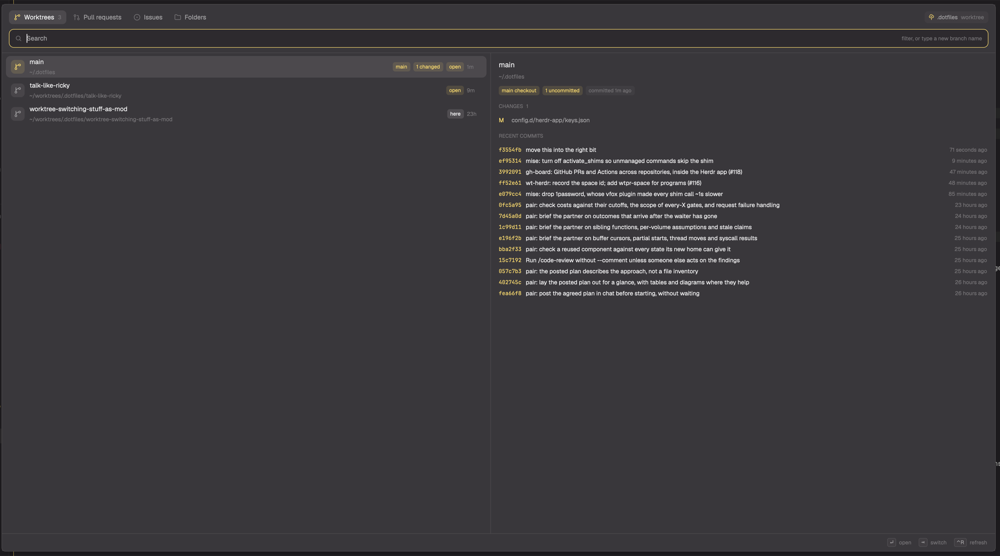

# Grove

A dialog for git worktrees in the Herdr app. Four tabs (Worktrees, Pull requests, Issues, Folders) share one search box and a list with a preview beside it; Enter opens the selection as a space, creating the worktree first when needed.

## What you see

A dialog, 80% × 74% of the window, `popover` background.

- **Header**, 28px pills, 14px side padding: one per tab, each a 14px Lucide icon (git-branch, git-pull-request, circle-dot, folder) and its label, then a dim item count once loaded. The active pill has the `selected` background and an `accent` icon. At the right, a 24px `raised` chip with a tree icon in `accent` and the repo's name (or the folder, outside git), plus "worktree" when the focused folder is a linked worktree and "on <machine>" for a remote space.
- **Search box**, 38px, 10px radius, `background` fill, 1px border in `accent` while focused and `input` otherwise: search icon, the input, and at the right either a spinning ring (loading) or the tab's hint in `dim` ("filter, or type a new branch name").
- **Body**, below a 1px `border` rule: the list on the left, the preview on the right behind a 1px left border. Under 760px wide the preview is hidden.
- **List rows**, 48px pitch, 9px radius: a 28px tile (an icon on a 13%-alpha tint of its colour), a title and a dim 11.5px second line, and chips on the right (10.5px, coloured text on a 12% tint). Selected: `selected` background; hover: `hover`.
- **Footer**, 36px, top border: busy text with a spinner, an error in `blocked`, or a warning in `ansi3`; then key hints as small bordered `raised` keycaps with dim labels, which change with the selection (`↵ open/create/check out/start`, `⇥ switch`, `⌃X remove`, `⌃O browser/finder`, `⌃R refresh`).

Row kinds:

- **Worktree**: branch icon tinted `accent` (main checkout), `ansi5` (agent worktree) or its PR state's colour. Title: branch; line two: path with `~`. Chips: `main`, `agent`, `locked`, `N changed` (`ansi3`), `#123 open|merged|closed|draft` (`ansi2`/`ansi5`/`ansi1`/`dim`), `here` (the focused pane is in it) or `open` (a space shows it), then the last commit's age.
- **Create** (plus icon, `accent`): "Create <name>", the path it will take.
- **Clean up** (trash icon, `ansi1`): "Clean up N finished worktrees", their names.
- **PR / issue**: title, then `#n · @who · branch` (`fork: <branch>` for a fork) or labels. Chips: `draft`, `approved`, `changes`, `worktree`/`open` when a checkout exists, age.
- **Reference** (link icon): "Open owner/repo#n".
- **Folder**: folder name, path, `open` when a space is there.

Preview: worktree: branch, path, chips (clean / N uncommitted / committed ago), the PR line, up to 12 changed files with their status letters, recent commits (hash in `ansi3` monospace, subject, relative time). PR: title, `#n · head → base`, chips (state, author, +add −del, files, failing/running/passing checks, review), a rule, the body as markdown. Issue: title, chips (state, author, labels, assignees, comments), body and the last three comments as markdown. Folder: branch chip and commits for a repo, else its entries.

## How it behaves

- Opens on the tab its launcher names, else the last tab used (`localStorage`). Outside git, with no tab named, it opens on Folders; repo tabs then say the folder isn't in a repository.
- Filter: every whitespace-separated word must match the row's text, as a substring (ranked earlier and at word starts higher) or as a subsequence; ties keep source order. `@me` means the signed-in GitHub login. PR and issue tabs start with `@me `.
- Keys: ↑/↓, ⌃N/⌃P, PgUp/PgDn move; Enter acts; Tab/⇧Tab change tab, each keeping its own query and selection; ⌃X arms removal on a worktree row (the row turns a 11% `blocked` tint and says "⌃X again to remove", plus how many uncommitted changes will be lost), a second ⌃X removes; after a refusal a third forces; ⌃O opens in the browser (`gh … --web`) or Finder; ⌃R reloads; Esc clears an armed removal or error, else closes.
- The list scrolls only as far as needed to keep the selection visible; the wheel scrolls and drags the selection along.
- Previews load 140 ms after the selection rests and are cached for the dialog's life.
- Worktree tab loads in stages: the list from `git worktree list`, then PR state from one `gh pr list --state all` and a `git status --porcelain` per checkout, all in parallel.
- Acting shows a spinner and a message in the footer; success closes the dialog, failure leaves the error there.

## Built from

- `mods/grove` (`mod.json`: `place: none`, dialog 0.8 × 0.74). Props: `{ mode, cwd, space }`, or `{ step: 1 | -1 }`, which renders nothing, selects the next or previous space in sidebar order and closes.
- Launchers `grove-worktrees`, `grove-prs`, `grove-issues`, `grove-folders`, `grove-next`, `grove-prev`: 2×2 frameless popups that read `focused()`, close themselves and `openOverlay({ mod: "grove", props })`. Mods can't import across folders, so all logic is in `grove`.
- `grove-shell`: `hc run --json --bg --rm --no-parent --cwd <focused cwd> -- zsh -i`, shown as a modal dialog with a terminal block.
- herdr: `spaces`, `panes`, `focused`, `theme`, `settings`, `props`, `run` (`space.select`, `space.new`, `space.close`), `openOverlay`, `closeOverlay`, `notify`, `exec`, `readTextFile`, `appHome`, `home`.
- Programs: `git`, `gh`, `zoxide`, `herdr-app do space.new` (to learn the new terminal) and `hc send` (to type `issueCommand`), `open`, `sh`, `test`.
- Config: `~/.config/herdr-app/grove.json` (`workspace`, `worktrees`, `issueCommand`, `mine`).
- Art: Lucide icons in `mods/grove/icons`, a ring spinner turned with `.spin(900)`.

## Watch out

- Theme colours may already be `#rrggbbaa`; replace the alpha rather than appending to it.
- `on_size_change` reports scaled pixels; divide by `settings().zoom`.
- `run()` returns nothing, so a command for a new space's terminal goes through `herdr-app do space.new`, whose output names the terminal.
- A space "is at" a checkout when its first terminal's live folder is inside it and not inside a deeper checkout; a folder row needs an exact match, or a parent folder would claim every repo space below it.
- Fork PRs: fetch `pull/<n>/head` into `pr/<n>`, not the head branch name, and never fall back to the default branch for a PR.
- The Clean up row only takes worktrees whose `git status` has come back clean; `null` (not known yet) never counts.
- `exec` has a 30 s limit; a slow `git fetch` fails the action with git's message.

## Done when

- `herdr-app check` passes for every folder in `mods/`.
- `alt-w` in a repo lists its worktrees with PR chips and change counts, and Enter on one selects its space or opens a space named after its branch.
- Typing an unused name and pressing Enter creates `<parent>/worktrees/<repo>/<name>` and opens it.
- In the PR tab, Enter on a fork's PR opens a worktree on `pr/<n>` holding the PR's head.
- In the Issues tab, Enter opens `<n>-<slug>` and types `issueCommand` into the new space.
- Pasting `https://github.com/<owner>/<repo>/pull/<n>` for another local repo opens a worktree of that repo.
- `cmd-]` from a main checkout's space goes to its first worktree's space.
